  

<h1 align="center">Hi there, I'm Deekshant 👋</h1>

  

  
  
  
  

<h2 align="center">🧠 About</h2>

  Student developer who likes building things that go deep — from encrypted peer-to-peer networks in Rust to full-stack web products. 
  Currently building <a href="https://github.com/geekshant/Esero"><b>Esero</b></a>, a Heterogeneous Resource Network where machines trade spare memory over QUIC with mTLS.

  🦀 Systems · networking · security &nbsp;&nbsp;|&nbsp;&nbsp; 🏛️ Civic tech &nbsp;&nbsp;|&nbsp;&nbsp; 🌱 Distributed systems &amp; cryptography

<h2 align="center">📊 Contributions</h2>

  <picture>
    <source media="(prefers-color-scheme: dark)" srcset="https://raw.githubusercontent.com/geekshant/geekshant/main/dist/heatmap-dark.svg">
    
  </picture>

  
  

  

<h2 align="center">🛠️ Tech Stack</h2>

  

  

<h2 align="center">🚀 Featured Projects</h2>

<table align="center" cellpadding="12">
  <tr>
    <td width="50%" valign="top" bgcolor="#0d1117">
      <h4>🦀 <a href="https://github.com/geekshant/Esero">Esero</a></h4>
      
Heterogeneous Resource Network — trade spare RAM across machines over encrypted QUIC channels with mutual TLS.

      
<code>Rust</code> <code>QUIC</code> <code>mTLS</code> <code>Protobuf</code>

    </td>
    <td width="50%" valign="top" bgcolor="#0d1117">
      <h4>🏛️ <a href="https://github.com/geekshant/JanSeva">JanMitra</a></h4>
      
Gamified civic complaint &amp; municipal governance platform for Bhopal — report, track, and fix city problems.

      
<code>Flutter</code> <code>React</code> <code>Supabase</code> <code>Mapbox</code>

    </td>
  </tr>
  <tr>
    <td width="50%" valign="top" bgcolor="#0d1117">
      <h4>🚀 <a href="https://github.com/geekshant/OwnSpace">OwnSpace</a></h4>
      
Full-stack workspace product with auth, billing, and an embedded code editor.

      
<code>Next.js</code> <code>Prisma</code> <code>TypeScript</code> <code>Vitest</code>

    </td>
    <td width="50%" valign="top" bgcolor="#0d1117">
      <h4>🌐 <a href="https://github.com/geekshant/portfolio">portfolio</a></h4>
      
Personal portfolio site with a terminal-inspired design.

      
<code>Vite</code> <code>JavaScript</code>

    </td>
  </tr>
</table>

   
  
  &nbsp;
  
   
  ⚡ This profile is itself a git repo

